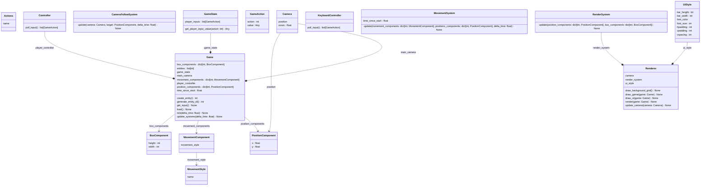
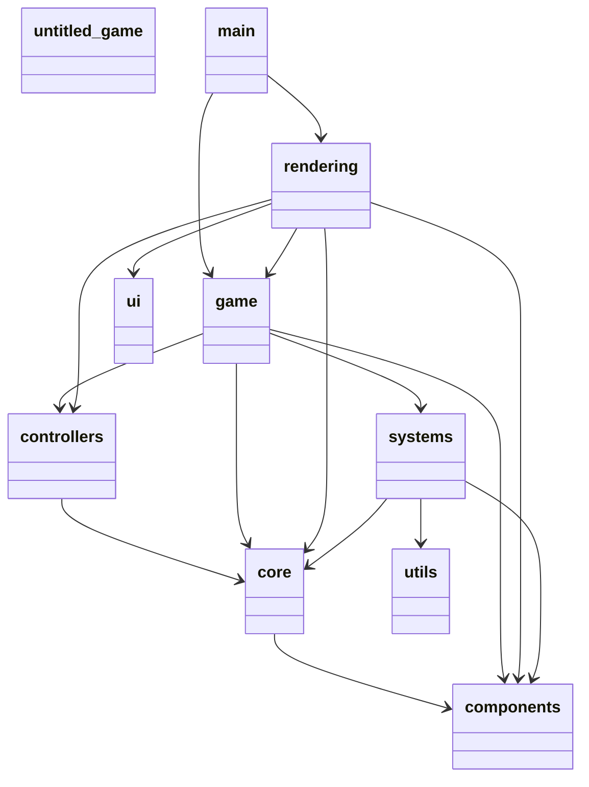

# Untitled Game

## Developer's Guide
### Prerequisites
- Visual Studio Code
- Python 3.13
- `uv`

### Install
```sh
uv sync
```

## Overview
```sh
uv run pyreverse -o mmd .\src\untitled_game
```
### Classes


### Packages
